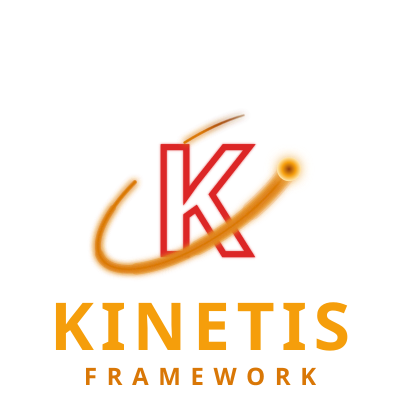

<p align="center">
  
</p>

<p align="center">
  <strong>kinetis/vector</strong>
  <br>
  <strong>A schema-driven admin platform for Kinetis applications</strong>
</p>

---

Part of [Kinetis](https://kinetis.dev/), a non-blocking PHP framework for
API-first applications.

This repository is the Vector monorepo. It holds the two packages Vector
is delivered as, and the demo application they are developed against:

| Path | What it is |
|---|---|
| `packages/vector` | `kinetis/vector` — the PHP package: the compiled resource registry, the REST admin API, the background jobs, and the MCP tools. Required by the demo application as a Composer `path` repository. |
| `packages/vector-ui` | `@kinetis/vector-ui` — the admin UI as a Nuxt 4 layer on Vuetify 4, published to npm. |
| `demo/` | The demo: everything that consumes the two packages the way an adopter would, plus the Docker stack that runs it. |
| `demo/backend` | The demo Kinetis application (`App\`), with `kinetis/vector` installed as a Composer path repository, JWT and session logins, and a `demo:seed` command. Two business domains on two databases: a shop (customers, orders, products, categories, tags) on MySQL, and a support desk (teams, agents, tickets, replies, labels) on PostgreSQL, each built to exercise every field type and relation shape Vector administers. |
| `demo/frontend` | The demo Nuxt application: it extends the layer and points at the demo API. |

The architecture, the decisions behind it and the phase plan are in
`~/Documents/Kinetis/Vector/KINETIS_VECTOR_MASTER_PLAN_2026-09-24.md`.

## Running it

```sh
cd demo
cp backend/.env.example backend/.env   # then set JWT_SECRET (see the file)
docker compose up --build -d           # app, worker, nginx, mysql, postgres, redis, node
docker compose exec app vendor/bin/kinetis migrate
docker compose exec --user www-data app vendor/bin/kinetis demo:seed
```

Every `docker compose` command in this file runs from `demo/`.

- The API answers on [http://localhost:8080](http://localhost:8080)
  (nginx + PHP-FPM; `/openapi` in development).
- The admin UI dev server answers on
  [http://localhost:3000](http://localhost:3000): the `node` service runs
  `pnpm install` and `nuxt dev` for `demo/frontend`. Sign in with
  `admin@vector.local` / `password`.
- MySQL 8.4 is on `localhost:3306` (`vector` / `vector`): the demo's
  domain, and the SQL queue table the test suite uses for a named
  connection of Vector's own.
- Redis 7 is on `localhost:6379`: the application's queue
  (the named queue connection `jobs`, `QUEUE_JOBS_CONNECTION=redis`).
- Uploaded files live on the private `storage` volume
  (`FILESYSTEM_DRIVER=local`, `FILESYSTEM_ROOT=/var/lib/vector-storage`),
  shared by `app` and `worker` and never served by nginx. Request bodies
  are allowed up to 12 MB (`MAX_BODY_SIZE` and nginx's
  `client_max_body_size`).
- PostgreSQL 17 is on `localhost:5432` (`vector` / `vector`) with two
  databases. `vector_support` holds the support desk, the named
  connection `support` (`DB_SUPPORT_*`; entities in
  `App\Domain\Support` declare `connection: 'support'`, migrations in
  `backend/migrations/support/`). `vector_admin` holds Vector's own
  tables, the named connection `admin` (`DB_ADMIN_*`,
  `VECTOR_DB_CONNECTION=admin` in `backend/.env`). They were published with
  `vendor/bin/kinetis vector:install --connection=admin` into
  `backend/migrations/admin/`, and `kinetis migrate` creates them. The
  MySQL copies in `backend/migrations/` are there too, so the suite can
  run against either:

  ```sh
  docker compose exec app vendor/bin/phpunit                                   # Vector's tables on PostgreSQL
  docker compose exec -e VECTOR_TEST_DB_CONNECTION=default app vendor/bin/phpunit  # on MySQL
  ```
- The **hosted** admin — the same UI served by the PHP application from
  `public/vector/ui` with the session cookie — needs the bundle built and
  published once:

  ```sh
  docker compose exec node pnpm --filter frontend generate:hosted
  docker compose exec app vendor/bin/kinetis vector:install
  docker compose restart app
  ```

  then open [http://localhost:8080/vector/ui](http://localhost:8080/vector/ui):
  it redirects to the application's own sign-in page at `/login`
  (`admin@vector.local` / `password`) and back. No Node is needed on a
  host that only serves the published bundle.

Docker is the only requirement on the host: the containers install the
PHP and Node dependencies and run everything. `demo/docker-compose.yml`
mounts the repository at `/workspace` and works in `demo/backend` (PHP)
and at the root (pnpm); `demo/backend/vendor/` and the three
`node_modules/` directories are named volumes.

In this development stack a PHP code change takes effect on the very
next request with no container restart, and the Nuxt dev server hot
reloads the UI. Production does not rediscover source on every request —
see [Deploying it](#deploying-it).

PHP errors are logged rather than displayed, so a response stays the
framework's own document with its own status code. The diagnostic is in
the `app` container's log:

```sh
docker compose logs -f app
docker compose logs -f node
```

`demo:seed --fresh` empties the demo tables and fills them again;
`--scale=N` multiplies the row counts. Most products get an image, which
the seed stores in Vector's storage as an upload would. Run the seed as
`www-data`, the user the application runs as; files stored as root are
not the application's to read.

## Testing it

Every command runs from `demo/`, with the stack up and seeded.

```sh
docker compose exec app vendor/bin/phpunit      # the API and the PHP package (see above for MySQL)
docker compose exec node pnpm test              # the admin UI layer: Vitest, no server needed
docker compose exec node pnpm typecheck         # vue-tsc over the layer and its tests
docker compose run --rm e2e                     # the admin in a browser, standalone and hosted
```

The end-to-end suite (`demo/e2e`, Playwright) needs the hosted bundle
published (above) and writes to the demo databases. Run it on its own,
not alongside PHPUnit. It clears the admin account's saved UI
preferences before each test. See
[demo/e2e/README.md](demo/e2e/README.md).

## Documentation

The user manual is in `docs/`: Markdown pages built by Sphinx into the
same site style as the Kinetis documentation. Docker is enough to build
it:

```sh
docker run --rm -v "$PWD/docs":/docs -w /docs python:3.12-slim \
    sh -c 'pip install -q -r requirements.txt && sphinx-build -W -b html . _build/html'
```

With Python installed, `make html` in `docs/` does the same. Open
`docs/_build/html/index.html`.

## Deploying it

The development stack above is not a deployment. Build the release or
image in this order:

```sh
composer install --no-dev --optimize-autoloader
php vendor/bin/kinetis build
```

then start workers against the generated artifact. The compiled cache
must be created in the built release or image itself — an existing
valid `.kinetis-cache/compiled.php` is used as-is and is not checked
against the source that produced it. See
[kinetis.dev/docs/caching.html](https://kinetis.dev/docs/caching.html)
for the complete build and artifact contract.

The admin UI builds with `pnpm --filter frontend generate` into
`demo/frontend/.output/public`, a static site any web server can host.

## Building it with an AI coding agent

Start the stack, open your agent in this directory, and describe what
you want built. `AGENTS.md` is the contract it works to: on the
earliest turn where the `orbitron` tools and resources are listed —
the first turn, or a later one, once the stack is up, the client has
reconnected, and the server is approved — it initializes Orbitron
before anything else, so it works from this project's real installed
versions and verified layout rather than from recalled framework
trivia. It cannot initialize between turns, so it checks again on every
turn until they are listed. A question about setup or these
instructions can still be answered while that connection comes up;
every other request, application work included, waits for it.

That initialization follows the order starting the server needs:

1. **Complete the stack's initial setup** — `docker compose up --build
   -d`, so the `app` image is built and its shared vendor volume is
   populated. The MCP server runs in a disposable container derived from
   that image, not in `app` itself.
2. **Reload, restart or reconnect the client** when this configuration
   arrived or changed after the session started, or when an earlier
   launch was attempted before the stack's initial setup completed. A
   client launches one server process per session, and Docker itself
   stopping or the client's own termination always end it — nothing the
   agent can do from inside that session brings it back. An `app`
   restart, recreation or rebuild does not end it: the server does not
   run inside that container. A complete `docker compose down` is
   outside that guarantee either way: on Compose v5.5.1, a live
   session keeps the project network in use, so `down` can remove `app`,
   leave the session alive, and still exit nonzero over that network
   being in use — end the client session first when you need a
   complete teardown.
3. **Approve the project-local `orbitron` server** under your client's
   own policy; see [Trust and approval](#trust-and-approval).
4. The agent confirms the `orbitron` tools and resources, reads
   `kinetis://orbitron/context` and `kinetis://docs/agent-workflow`,
   calls `orbitron_inspect`, confirms the `checkoutRoot` it reports is
   this checkout's `pwd -P`, and calls `orbitron_verify`.
5. It reports readiness in one line and gets on with your request:

   ```
   Orbitron ready — kinetis/framework <installed-version>, layout pass (App\, App\Tests\).
   ```

An agent with a shell does step 1 itself. Steps 2 and 3 are yours: it
cannot reconnect the server process it is running inside, and it cannot
grant its own approval. When any step fails it is required to stop, name
the step, quote the exact error, and bring you to
[Diagnostics](#diagnostics) rather than guess. A refusal to start is the
contract working.

### What is checked in for that

Already correct for whatever path you cloned into:

- `AGENTS.md` — the agent contract, and the only place it is written.
  `CLAUDE.md` and `GEMINI.md` are one-line imports of it.
- `bin/orbitron-mcp` plus one config file per client — `.mcp.json`,
  `.codex/config.toml` and `.gemini/settings.json`. Each registers the
  stdio MCP server named `orbitron`, launched as `./bin/orbitron-mcp`,
  plus the Nuxt, Vuetify and Vue documentation servers used for
  frontend development.

`bin/orbitron-mcp` runs `docker compose run --rm -T --no-deps
--entrypoint php -e KINETIS_ORBITRON_CHECKOUT_ROOT=<checkout> app
vendor/bin/kinetis-orbitron-mcp` against this project's own directory:
a disposable container built from `app`'s own image, sharing its project
and vendor mounts but not its process lifecycle, so restarting,
recreating or rebuilding `app` does not disconnect an established
session. `--entrypoint php` skips the entrypoint's `composer install`,
and `--no-deps` keeps the launcher from starting MySQL or Node, which it
does not need. The container sees every checkout as `/workspace/demo/backend`, so
`<checkout>` is this checkout's physical host path, which
`orbitron_inspect` reports back as `checkoutRoot`. The server still
lives next to the code it reports on, so your host still needs no PHP
and no Composer, and the agent needs no absolute path.

That one server is the whole registration. The Kinetis documentation
pages arrive on the same connection as `kinetis://docs/*` resources,
fetched by [`kinetis/mcp-docs`](https://kinetis.dev/docs/mcp-docs.html)
from inside it — there is no second server to configure, and
`kinetis://docs/agent-workflow` is where the agent starts. It reads a
page with the same package's `kinetis_read_doc` tool from line 1,
continuing only while the section it was routed to is unresolved; the
whole-page resources stay available for when a complete page is what it
needs. Those pages are published from Kinetis `main`, so
`orbitron_inspect` and the four installed-source tools —
`orbitron_read_package_source` for a bounded
line window of one installed package's own file,
`orbitron_search_package_source` for the lines of one such file that
contain a literal string, `orbitron_search_package_source_tree` for the
lines of a bounded directory tree of such a package that contain one,
and `orbitron_list_package_source` for the
direct children of one directory of such a package, all read live over
that same connection — stay the authority for anything
version-sensitive. Any package this project installed is readable that
way, `kinetis/vector` from `packages/vector` included, so the same four
calls settle a third-party dependency's exact behavior as well as a
`kinetis/*` one; `orbitron_inspect` names the `kinetis/*` packages, and
`composer.lock` names every other. An agent with that MCP connection
reads the package's own `composer.json` first. When the file is known,
it searches that file and reads a window around a reported line. When
only the package is known, it searches the package tree, narrows the
query or path when `hasMore` is `true`, and narrows the path, most
commonly to `src`, on a `package_search_oversize` refusal. It lists a
directory when the layout itself is what it needs. A `hasMore: true`
from a window or a file search is a success, not a refusal: the agent
continues from `endLine + 1`, or from the last reported match line plus
one, before treating the file as exhausted. It reaches
`vendor/<vendor>/<package>` only when none of those yields a file or a
call is refused — `vendor/` is a Docker volume, so that means reading it
inside the container. A shell-only agent has no such call to make and
reads it in the container from the start.

One consequence of the `path` repository: `vendor/composer/installed.json`
records `packages/vector/composer.json` as it was when Composer last
installed it. After changing that file — its `extra.kinetis` keys
especially — run `docker compose exec app composer update kinetis/vector`
so discovery and Orbitron see the change.

### Verifying a change

The PHP tools run inside the `app` container, over the project at `/workspace/demo/backend`;
the frontend tools inside `node`:

```sh
docker compose exec app vendor/bin/phpunit
docker compose exec app vendor/bin/phpstan analyse
docker compose exec app vendor/bin/kinetis build
docker compose exec node pnpm typecheck
docker compose exec node pnpm --filter frontend generate
```

`demo/backend/phpstan.neon` runs at level 8 over the demo's `src/`,
`migrations/` and `bootstrap.php` and over `packages/vector/src/`,
includes the ORM's extension, and adds
two rules a general-purpose analyser has no reason to carry.
`NoStaticPropertiesRule` flags a `static` property, which survives every
request the worker goes on to handle; `NoBlockingIoRule` flags a call
that waits synchronously instead of yielding, holding the event loop and
everything else on it until it returns.

They are guardrails over two specific mistakes, not a complete proof of
persistent-worker correctness. `AGENTS.md` asks for a closing pass by
hand as well — request-scoped state stays request-scoped, waits yield,
credentials stay where they belong, and the documentation still matches
the behavior — and, at a material milestone, a re-read of this README's
framing for application-specific claims the work made false. The reusable
Kinetis and Orbitron setup reference stays unless the implementation
actually invalidated it.

### Trust and approval

The checked-in files register a server and configure nothing else: no
credential, no trust override, no preapproved tool. Whatever trust and
approval policy your client already runs under is what applies, and it
differs by client — Claude Code prompts about a project-scoped
`.mcp.json` in an interactive session (its documented non-interactive
and policy-managed modes can behave differently), Codex reads
`.codex/config.toml` only for a trusted project, and Gemini CLI may
ignore workspace settings in an untrusted workspace, where an omitted
server `trust` leaves that server's default `false`.

Reload or restart the client when this configuration was added or
changed after the current session started, or when its tool catalog has
not picked the server up yet.

### Client differences

The launcher and the contract are the same everywhere. What differs is
where a client looks and what its own trust boundary is:

| Client | Reads instructions from | Project MCP configuration |
|---|---|---|
| Claude Code | `CLAUDE.md` (imports `AGENTS.md`) | `.mcp.json`, subject to its project-server prompt in an interactive session |
| Codex | `AGENTS.md` | `.codex/config.toml`, read for a trusted project |
| Gemini CLI | `GEMINI.md` (imports `AGENTS.md`) | `.gemini/settings.json`, subject to workspace trust |
| Any other MCP-capable client | `AGENTS.md` | register `./bin/orbitron-mcp` as a stdio server named `orbitron` |

A client that reads none of those three file names still works: point it
at `AGENTS.md` yourself and register the launcher the way it registers
any stdio server.

### Without MCP

The four documents are commands too, so an agent that can only run a
shell — or you, reading them yourself — has all of them:

```sh
docker compose exec app vendor/bin/kinetis orbitron:context
docker compose exec app vendor/bin/kinetis orbitron:inspect
docker compose exec app vendor/bin/kinetis orbitron:verify
docker compose exec app vendor/bin/kinetis orbitron:scaffold
```

`orbitron:scaffold` previews; `orbitron:scaffold --apply` is the only
one of them that writes anything, and what it writes is two fixed files.
Inside the container, `orbitron:inspect` reports `/workspace/demo/backend` as both
`projectRoot` and `checkoutRoot`: it names the container's view, not
the host checkout.
See [Appendix: Orbitron](https://kinetis.dev/docs/appendix-orbitron.html)
for every document's shape and exit code.

### Diagnostics

**The stack has not completed its initial setup.** `bin/orbitron-mcp`
launches a disposable container from the `app` service's image, so a
first attempt before that image exists, or before its vendor volume is
populated, fails — Compose can build the image and create the volume,
but `vendor/bin/kinetis-orbitron-mcp` does not exist inside it yet. Bring
the stack up from this directory and restart the client:

```sh
docker compose up --build -d
docker compose ps
```

**An `app` restart, recreation or rebuild does not disconnect
Orbitron.** The MCP process runs in its own disposable container, not
inside `app`, so `docker compose restart app`, `docker compose up
--build -d app`, or any `app` recreation leaves an established session
connected. There is nothing to do here.

**The server was there and is gone.** A Docker shutdown, or the client
itself ending its own process, removes the one-off container and
requires the client to launch or connect again. The stack itself can
still be healthy.

**`docker compose down` exits nonzero over a network still in use.** A
live Orbitron session keeps its one-off container attached to the
project network, so `down` can remove `app` and then fail on the
network:

```text
Network <project>_default Resource is still in use
```

End or close the client session so its one-off container is disposed,
then run `down` again — it completes once nothing still holds the
network. Relaunch the client once the stack is back up.

**The server shows as disconnected.** Run the launcher yourself — it is
an ordinary command, and a working server answers a handshake on stdin:

```sh
printf '%s\n' '{"jsonrpc":"2.0","id":1,"method":"initialize","params":{"protocolVersion":"2025-06-18","capabilities":{},"clientInfo":{"name":"manual","version":"0"}}}' \
    | ./bin/orbitron-mcp
```

A JSON-RPC result naming `kinetis-orbitron-mcp` means the bridge and the
server are both fine, and what remains is client-side: its trust and
approval policy, or a tool catalog that has not picked the server up
since the configuration arrived.

**A dependency change needs no restart.** Orbitron reads this project's
generated inventory again for every package-aware call, so after a
successful dependency change —

```sh
docker compose exec app composer require kinetis/queue
```

— the next `orbitron_inspect`, `orbitron_verify`, or installed-source
call already sees it. This is not one of the restart cases above: those
are new or changed MCP configuration, a launch attempted before the
stack's initial setup completed, and Docker itself stopping.

**`orbitron_verify` reports an error.** The `code` in each failed check
names the outcome. This project keeps the layout Orbitron admits — one
`autoload.psr-4` prefix mapped to `src/`, one `autoload-dev.psr-4`
prefix mapped to `tests/` — so an error here means the root
`composer.json` has moved away from it.
[Appendix: Orbitron](https://kinetis.dev/docs/appendix-orbitron.html#orbitron-verify)
lists every code.

## The admin API

Every Vector route sits under `/vector` behind the `vector` middleware
group — the application's authentication middleware (here
`App\Auth\VectorAuthMiddleware`) followed by Vector's own
`VectorAccessMiddleware`, which asks the application-bound
`VectorAccessInterface` whether the authenticated user may enter. A
request without an identity is `401`; one the application does not admit
is `403`.

| Route | Answers |
|---|---|
| `GET /vector/schema` | The descriptor: every resource this user may list, its fields, table and show views, permissions, and the menu. Carries an `ETag`; `If-None-Match` answers `304`. |
| `GET /vector/schema/{resource}` | One resource of it. |
| `GET /vector/me` | The authenticated identity. |
| `GET /vector/r/{resource}` | A page of records under the list grammar: `page`, `perPage` (bounded by the resource), `sort=-createdAt,name` over sortable fields, `filter[field][op]=value` over filterable fields with the operators the descriptor publishes (`eq ne lt lte gt gte in nin like nlike between null nnull`; `filter[field]=value` is `eq`, `in`/`nin`/`between` take `a,b`), `filter[or][i]…` alternatives and `filter[and][i]…` combined filter objects (four deep, 50 conditions), `filter[trashed]=only|with` on a soft-deleting resource, `q` over searchable fields, `group=field`, `summaries=1`, `columns=a,b`, or `cursor` for keyset pages by the identifier. The Kinetis `Paginator` envelope (or `{data, nextCursor, hasMore}` under a cursor), `belongsTo` values as `{id, label}`, `hasMany`/`manyToMany` as `{count}`, `summaries` when asked, `_trashed` on a soft-deleting resource. |
| `GET /vector/r/{resource}/export` | The same grammar as a CSV download, inline up to the resource's export limit. |
| `GET /vector/r/{resource}/{id}` | One record with every show field and its permissions: `update`, `delete`, `restore`, `forceDelete`, and the `actions` this user may run on it. |
| `POST /vector/r/{resource}` | Creates a record from a JSON object of field values; `201` with the record, or the standard `422` document naming every failing field. |
| `PATCH /vector/r/{resource}/{id}` | Partial update. `If-Match: "<version>"` (or a `version` member) against the entity's `#[Version]` column answers `409` on a stale row. |
| `DELETE /vector/r/{resource}/{id}` | Deletes the record and, through the ORM, the aggregate it owns; `204`. A resource that declares `softDeletes()` stamps the row instead, unless `?force=1`. |
| `POST /vector/r/{resource}/{id}/restore` | Takes a soft-deleted record out of the trash. |
| `POST /vector/r/{resource}/batch` | `{"action": "delete"\|"restore"\|"forceDelete", "ids": [...]}` or `"all": {"filter": ..., "q": ...}` for every record the selection matches, within the resource's bulk limit. `{"action": "update", "fields": {...}}` writes the same values to every selected record: validated once, authorized and audited per record, one transaction. |
| `POST /vector/r/{resource}/changes` | `{"changes": [{"id", "version", "values": {...}}, ...]}`, the list's inline edits: different values for different records, each authorized, validated, version-checked and audited like a `PATCH`, all in one transaction. A violation names `changes/{index}/{field}`; one stale record answers `409` for the whole changeset. |
| `POST /vector/r/{resource}/actions/{action}` | Runs an action on `ids`, on `all: {filter, q}`, or on nothing when it is standalone, with `fields` validated like a form. Answers `{type, message, url, affected}` — `message`, `danger` (422, nothing flushed), `redirect`, `url` — or a file download. |
| `GET /vector/r/{resource}/{id}/{relation}/rows` | A repeater's rows: every child of the record as the child resource shows one, for the edit form. Create and patch take the whole list under the field's name: a row with an `id` updates that child, one without creates it, one left out is deleted; a row's violation names `field/{row}/{column}`. |
| `GET /vector/r/{resource}/{id}/{relation}` | A page of the records a `hasMany` or `manyToMany` field holds, as the target resource lists them. |
| `POST /vector/r/{resource}/{id}/{relation}/attach`, `…/detach` | `{"ids": [...]}` adds records to, or removes them from, a `manyToMany` field; each is authorized by the policy's `attach` or `detach`, logged and audited. |
| `GET /vector/r/{resource}/fields/{field}/options?q=` | Options for a relation input, searching the target's title; `?ids=` resolves known identifiers. A `dependsOn` relation narrows by `depends[{field}]=` (the form's value of the field it depends on). |
| `GET /vector/badges` | The menu's badges: for every resource with a `badge()` this user may list, `{count, color, label}` by slug, the count of its filter as the user's list counts it. |
| `GET /vector/search?q=` | Global search: the first matches of every globally searchable resource this user may list, each with its `title`, the resource's `searchSubtitle()` value as `subtitle`, and, when the record holds one, the `searchImage()` field to fetch its thumbnail from as `image`. |
| `GET/POST /vector/views/{resource}`, `PUT/DELETE /vector/views/{resource}/{id}` | Saved list views — a name, a validated list state, `shared`, `isDefault`, and `resourceDefault` (a shared view everyone without a default of their own opens with; one per resource; the policy's `setDefaultView` decides it); the owner alone changes one. |
| `GET/PUT /vector/preferences` | Per-user UI preferences as JSON values by key (`columns.<resource>`, …); `PUT` merges, a `null` removes. |
| `GET /vector/settings`, `GET/PUT /vector/settings/{group}` | Typed settings groups (`#[Settings]` classes extending `SettingsGroup`) with their values; `PUT` validates the body like a form and replaces the group's values. `branding` ships with Vector and is published with the descriptor. |
| `POST /vector/r/{resource}/fields/{field}/upload` | Stores one file (multipart `file`) for a file or image field after detecting its format from the bytes; answers `{key, name, size, type}`, the key being the value to write. |
| `GET /vector/r/{resource}/{id}/files/{field}` | The record's stored file: an image inline, anything else as an attachment. `?key=` serves an image one of the record's rich-text documents shows from that field's uploads. |
| `GET /vector/r/{resource}/{id}/audit` | The record's audit trail: every event with the field-level changes the writer observed, the actor and, when impersonating, the impersonator. |
| `POST /vector/r/{resource}/{id}/audit/{entry}/revert` | Puts back the `from` values of one `update` or `revert` entry, for the fields this user may see and edit, through the update path; audited as `revert`. `409` when one of those fields changed since. |
| `GET /vector/r/{resource}/widgets/{widget}?range=` | A resource widget's data. |
| `POST /vector/r/{resource}/import/preview`, `POST /vector/r/{resource}/import` | CSV import (multipart `file`, then `mapping` as JSON, `mode` and `key`): the preview answers headers, a sample and a suggested mapping; the import stores the file on a job and queues it. Every row is one create, or — in `update`/`upsert` mode — an update of the record its `key` column (the id or a unique field) matches, through the writer; failed rows come back as a file. |
| `POST /vector/r/{resource}/actions/{action}` (queued) | An action whose class declares `queued()` answers `202 {type: "job", jobId}` and runs in chunks in the worker. |
| `GET /vector/jobs`, `GET /vector/jobs/{id}`, `GET /vector/jobs/{id}/download` | The caller's background jobs — queued actions, large exports, imports — with progress to poll and the file a finished one left. |
| `GET /vector/dashboards/{name}`, `GET /vector/dashboards/{name}/widgets/{widget}?range=` | A dashboard's cards, and one card's data for a range (`7d`, `30d`, `90d`, `1y`, … as the widget declares). |
| `GET /vector/notifications`, `POST /vector/notifications/{id}/read`, `POST /vector/notifications/read-all` | The inbox: what jobs and actions left for this admin. |
| `POST /vector/impersonate/{userId}`, `DELETE /vector/impersonate` | Act as another user through the application's `ImpersonationInterface`: a re-issued token in bearer mode, a swapped session in cookie mode; both logged. |
| `POST /mcp` | The same services as MCP tools (`vector_resources`, `vector_query`, `vector_get`, `vector_create`, `vector_update`, `vector_delete`, `vector_run_action`, `vector_widget`) and the `vector://schema` resource, under the application's `mcp`-group authentication and Vector's access policy; `kinetis mcp:serve` serves them over stdio and fails closed without an identity. |
| `GET /vector/ui`, `GET /vector/ui/{path}` | Hosted mode: the shell page for every deep link, with `window.__VECTOR__` (configuration, the CSRF token, branding, the response's script nonce) injected; `302` to `VECTOR_LOGIN_URL` for an anonymous visitor, `503` until `vector:install` published the bundle. |

Two authentication modes reach the same routes. **Bearer mode** sends
`Authorization: Bearer <jwt>` from `/auth/login` — what the standalone UI
on `localhost:3000` does. **Cookie mode** rides the session the
application's `/login` page opened and must send the `X-CSRF-Token` the
shell handed out on every unsafe method — what the hosted UI does. The
demo's `App\Auth\VectorAuthMiddleware` accepts either and sits in the
`vector` and `vector-shell` groups after `VectorSessionMiddleware`.

A resource is a class extending `Kinetis\Vector\VectorResource` carrying
`#[Resource(entity: ...)]`; an empty class derives every field from the
entity's ORM metadata, and `fields()` replaces derivation (see
`demo/backend/src/Vector/ProductResource.php`, which also declares `softDeletes()`,
two `summarize()` columns and five actions). An action is a class
extending `Kinetis\Vector\Actions\VectorAction` — its `fields()` become a
dialog, `canRun()` decides per-record visibility, `handle()` receives the
loaded entities and answers an `ActionResponse` (see
`demo/backend/src/Vector/Actions/`). The registry compiles at `kinetis build` and at
each development boot; a field, sort, filter, column or action a request
names is checked against that compiled allow-list, so no request text
ever reaches SQL as an identifier.

Background work runs through `kinetis/queue`, on the application's
queue: the Redis backend (`kinetis/queue-redis`) on the `redis` service,
through the named queue connection `jobs` (`QUEUE_CONNECTION_NAME=jobs`,
`QUEUE_JOBS_CONNECTION=redis`, `REDIS_JOBS_HOST=redis`) so no bare
`REDIS_HOST` rebinds the application's cache. Vector's jobs
use that same queue under a name of their own, `vector`
(`VECTOR_QUEUE`), and the application's one `worker` service serves
both names, `queue:work --queue=default,vector`, application jobs
first. A queued action handles its selection in chunks, an export
above the resource's inline limit builds its file in the worker, and an
import creates rows one by one. Jobs run as the admin who started them —
the application binds `ActorResolverInterface` to rebuild that identity
— and report into `vector_jobs`, which the UI polls; a finished job also
leaves a notification. Widgets (`VectorWidget`: stat, trend, partition,
progress, table) and dashboards (`#[Dashboard]` classes) compute on the
query builder for a range and may memoize per worker for a few seconds;
see `demo/backend/src/Vector/Widgets/` and `demo/backend/src/Vector/Dashboards/`.

Runtime UI extensions are plain ES modules the admin imports after boot
— `VECTOR_UI_EXTENSIONS` in hosted mode, `runtimeConfig.public.vector.extensions`
in standalone mode — and register cells, inputs, widget renderers or
custom pages through `window.Vector`, which hands them Vue, a curated set
of Vuetify components and the admin's API client. The demo has two:
`demo/backend/public/vector-extensions/stock-level.js`, a cell wired to
the products' stock column with `->component('stock-level')`, and
`stock-overview.js`, a "Stock overview" page under Catalog that reads the
demo endpoint `GET /vector-demo/stock-overview`
(`demo/backend/src/Http/StockOverviewController.php`, in the `vector`
middleware group).

The product description is a rich-text document (headings, lists, links,
tables, images) and a ticket's body a rich-text field that stores HTML;
ticket replies are Markdown. The shop's own product page,
`GET /shop/products/{id}` (`demo/backend/src/Http/ProductPageController.php`,
public, not part of the admin), renders the description through
`Kinetis\Vector\RichText\Document::toHtml()`, and `demo:seed` writes
the descriptions as documents.

The demo sends one `Content-Security-Policy` for the whole application:
the framework's `SECURITY_CSP`, `{nonce}` replaced per request. The
hosted shell puts that request's nonce on every inline script tag, and
the sign-in page puts it on its style. `.env.example` ships the strict
policy the demo runs under (`script-src 'self' 'nonce-…'`, no CDN; the
icon font is bundled). `VECTOR_SHELL_CSP` would give the shell a policy
of its own instead. `VECTOR_SHELL_HEAD` appends a raw fragment before `</head>`:
the deployer's way, and the only way, to add script to the admin.
Branding — title, logo URL, theme colours, footer line — is a settings
group an admin edits at `/settings`, stored as values and rendered
escaped.

## Layout

```text
packages/vector/          kinetis/vector (PHP): registry, API, jobs, MCP tools, migration stubs, docs
packages/vector-ui/       @kinetis/vector-ui (Nuxt layer); its Vitest suite in test/nuxt/
demo/docker-compose.yml   the stack: app, worker, nginx, mysql, postgres, redis, node (and e2e, run on demand)
demo/docker/              the PHP image, nginx and php.ini
demo/backend/             the demo Kinetis application, with kinetis/vector installed from ../../packages/vector
  src/Auth/               JWT login (/auth/login, /auth/me), session login (/login, /logout), the vector and mcp group middleware, impersonation
  src/Console/            demo:seed
  src/Domain/             the shop's entities and enums, on MySQL (kinetis/orm)
  src/Domain/Support/     the support desk's entities and enums, on PostgreSQL
  src/Vector/             the demo's resources, actions, widgets, dashboards and settings groups
  src/Vector/Support/     the support desk's resources, action and widgets
  migrations/             the demo schema, the Vector migrations for MySQL, the queue table
  migrations/admin/       the Vector migrations for PostgreSQL on the named connection admin
  migrations/support/     the support desk's schema, on the named connection support
  bootstrap.php           JWT keys, CORS for the standalone UI origin, the Vector bindings
  public/vector/ui/       the published hosted bundle (generated; not committed)
  public/vector-extensions/  the demo's runtime UI extension
  tests/                  PHPUnit (App\Tests\)
demo/frontend/            the demo Nuxt app: extends @kinetis/vector-ui, points at the demo API
demo/e2e/                 the end-to-end suite: Playwright, both deployment modes, against the running stack
docs/                     the user manual (Sphinx, MyST Markdown)
bin/orbitron-mcp          launches the Orbitron server for demo/backend
```

`demo/backend/public/index.php` is the Composer autoloader plus one
`Kinetis\Runtime\HttpStartup::run()` call — the framework owns the
startup program itself. Controllers, commands, entities and Vector
resources anywhere under `App\` or `Kinetis\Vector\` are discovered
automatically.

## License

MIT — see [LICENSE](LICENSE).
